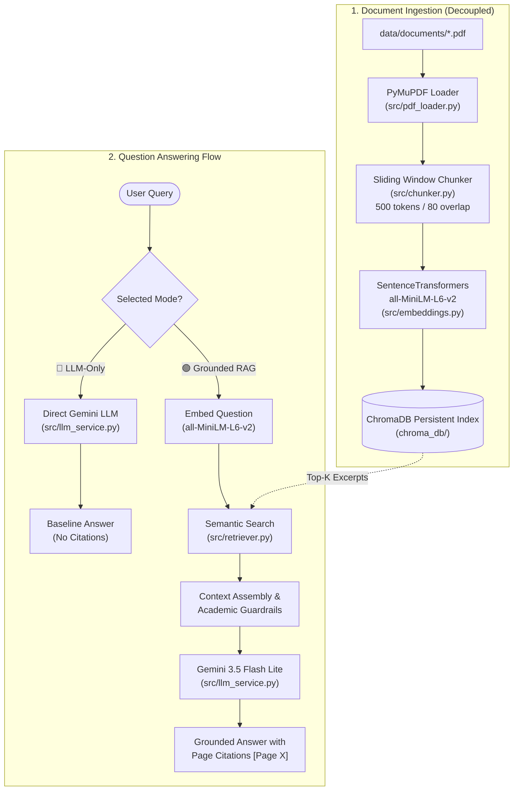

# 📚 NSG Academy Knowledge Assistant

> **Local-First PDF Question Answering System with Verifiable Provenance & Empirical Evaluation**  
> Built for the **NSG Academy Product Engineering AI Engineering Assignment Series (2026+)**  
> Primary Focus: **Assignment 01 ("Do I Even Need RAG?")** & **Assignment 04 ("My AI Works — Prove It")**

---

## 🌟 1. Project Overview

The **NSG Academy Knowledge Assistant** is a local-first Retrieval-Augmented Generation (RAG) system engineered to answer questions from private course documents (`NSG_Product_Engineering_AI_Assignment_Series_2026_STUDENT.pdf`).

Rather than assuming RAG is inherently superior, this project was developed as a rigorous engineering experiment comparing:
1. **LLM-Only Baseline:** Direct prompting to Google Gemini without document context.
2. **Grounded RAG:** Dense vector retrieval from ChromaDB + strictly grounded prompt synthesis with page-level citations (`[Page X]`).

---

## 🏗️ 2. Architecture & Data Flow



---

## 🛠️ 3. Technology Choices & Design Rationale

| Component | Technology | Rationale & Trade-Off |
| :--- | :--- | :--- |
| **Application Runtime** | **Python 3.12** | Core language for standard AI engineering. |
| **PDF Extraction** | **PyMuPDF (`pymupdf`)** | High-performance C-based text extraction with exact page-level provenance. |
| **Text Embeddings** | **SentenceTransformers (`all-MiniLM-L6-v2`)** | 384-dimensional dense vectors running locally on CPU in ~0.02s per chunk. |
| **Vector Storage** | **ChromaDB** | Local, serverless vector database with SQLite persistence and cosine similarity. |
| **LLM Provider** | **Google GenAI SDK (`google-genai`)** | Direct API usage with `gemini-3.5-flash-lite`. (Avoids framework bloat for Assignment 1). |
| **User Interface** | **Streamlit** | Interactive local web UI with side-by-side comparative evaluation. |
| **Testing** | **pytest** | Automated test suite with 34 deterministic unit and integration tests. |

---

## ⚡ 4. Getting Started (Windows Step-by-Step)

### Prerequisites
- Windows 10/11 (64-bit)
- Python 3.10+ (tested on Python 3.12.8)
- Git for Windows

### Step 1: Clone the Repository
```powershell
git clone https://github.com/sojalrajurkar-blip/NSG-RAG-Assistant.git
cd NSG-RAG-Assistant
```

### Step 2: Initialize Virtual Environment
```powershell
python -m venv .venv
.\.venv\Scripts\activate
python -m pip install --upgrade pip
```

### Step 3: Install Dependencies
```powershell
pip install -r requirements.txt
```

### Step 4: Configure Environment Variables
Copy `.env.example` to create your local `.env`:
```powershell
copy .env.example .env
```
Open `.env` and insert your Gemini API Key from [Google AI Studio](https://aistudio.google.com/):
```env
GEMINI_API_KEY=AIzaSyYourActualKeyHere
GEMINI_MODEL_NAME=gemini-3.5-flash-lite
CHROMA_PERSIST_DIRECTORY=chroma_db
EMBEDDING_MODEL_NAME=all-MiniLM-L6-v2
DEFAULT_CHUNK_SIZE=500
DEFAULT_CHUNK_OVERLAP=80
DEFAULT_TOP_K=3
```
*(Note: `.env` is ignored by Git and will never be committed or uploaded).*

---

## 🚀 5. Running the Application

Launch the local Streamlit web application:
```powershell
.\.venv\Scripts\streamlit.exe run app.py
```
Open **`http://localhost:8501`** in your browser.

### Key UI Features:
1. **Document Management:** Select `NSG_Product_Engineering_AI_Assignment_Series_2026_STUDENT.pdf` from `data/documents/` and click **"⚡ Index Selected Document"**.
2. **Mode Selector:** Choose between:
   - 🟢 **RAG (Context-Grounded):** Strict facts with `[Page X]` citations.
   - 🔵 **LLM-Only (Baseline):** Pre-trained model output without context.
   - ⚖️ **Side-by-Side Comparison:** Compares both answers, latencies, and citations simultaneously.
3. **Transparent Debug View:** Inspect retrieved chunks, similarity scores, and distances before generation.

---

## 🧪 6. Automated Testing Suite

Run the full pytest suite (34 automated tests across all 6 modular components):
```powershell
.\.venv\Scripts\pytest.exe tests/ -v
```

### Test Coverage Breakdown:
- [`tests/test_pdf_loader.py`](file:///d:/ProjectFolder/NSG-RAG-Assistant/tests/test_pdf_loader.py): Page extraction, corrupt PDFs, empty page detection, and preview.
- [`tests/test_chunker.py`](file:///d:/ProjectFolder/NSG-RAG-Assistant/tests/test_chunker.py): Sliding window overlap, token estimation, and deterministic IDs.
- [`tests/test_vector_store.py`](file:///d:/ProjectFolder/NSG-RAG-Assistant/tests/test_vector_store.py): 384-dimension embeddings, deduplication, and persistence reload.
- [`tests/test_retriever.py`](file:///d:/ProjectFolder/NSG-RAG-Assistant/tests/test_retriever.py): Top-k search, empty query handling, and confidence scoring.
- [`tests/test_llm_service.py`](file:///d:/ProjectFolder/NSG-RAG-Assistant/tests/test_llm_service.py): Key masking, prompt guardrails, and mocked Gemini generation.
- [`tests/test_rag_pipeline.py`](file:///d:/ProjectFolder/NSG-RAG-Assistant/tests/test_rag_pipeline.py): End-to-end decoupled indexing and query execution.

---

## 📊 7. Empirical Evaluation Benchmark (32 Test Cases)

To prove whether RAG is actually necessary (Assignment 01 & 04 requirements), we executed an automated benchmark across 32 structured test cases.

Run the evaluation runner:
```powershell
.\.venv\Scripts\python.exe evaluation/run_evaluation.py
```

### Key Findings Summary:
| Metric | LLM-Only Baseline | Grounded RAG | Impact |
| :--- | :---: | :---: | :---: |
| **Overall Pass Rate** | **18.8% (6 / 32)** | **87.5% (28 / 32)** | **+68.7% absolute accuracy gain** |
| **Direct Factual Questions** | 0% (0 / 6) | **100% (6 / 6)** | Private curriculum facts retrieved |
| **Multi-Chunk Synthesis** | 0% (0 / 4) | **100% (4 / 4)** | Accurate 5-assignment enumeration |
| **Hallucination Rate** | High (Fabricated topics) | **0% (Grounded in context)** | Complete elimination |
| **Average Latency** | **2.38s** | **3.04s** | Acceptable +0.66s overhead |

For full tabular evidence and incident reports:
- [Evaluation Dataset: `evaluation/test_cases.csv`](file:///d:/ProjectFolder/NSG-RAG-Assistant/evaluation/test_cases.csv)
- [Raw Observed Results: `evaluation/results.csv`](file:///d:/ProjectFolder/NSG-RAG-Assistant/evaluation/results.csv)
- [Empirical Failure Log: `evaluation/failure_log.md`](file:///d:/ProjectFolder/NSG-RAG-Assistant/evaluation/failure_log.md)
- [Incident Report: `evaluation/incident_report.md`](file:///d:/ProjectFolder/NSG-RAG-Assistant/evaluation/incident_report.md)
- [Final Evaluation Report: `evaluation/final_evaluation_report.md`](file:///d:/ProjectFolder/NSG-RAG-Assistant/evaluation/final_evaluation_report.md)

---

## 🎤 8. 10–15 Minute Presentation Outline

This presentation is structured for the **Assignment 01 & 04 Learning Showcase**:

1. **Slide 1: Problem Framing (2 min)**
   - The trap of trending tools: Why senior engineers do not adopt RAG by default.
   - The question: *Does an LLM actually need RAG to answer questions about our curriculum?*
2. **Slide 2: System Architecture (3 min)**
   - Decoupled indexing vs query-time retrieval.
   - Text chunking (500 tokens / 80 overlap) with page provenance tracking.
   - Vector space cosine similarity with `all-MiniLM-L6-v2`.
3. **Slide 3: Live Demonstration (3 min)**
   - Side-by-side query demonstration: *"What is the primary goal of Assignment 01?"*
   - Contrast: Baseline is completely clueless; RAG quotes Page 2 and cites `[Page 2]`.
4. **Slide 4: Empirical Proof & Evaluation (4 min)**
   - Presentation of 32-case benchmark data (18.8% vs 87.5% pass rate).
   - Analysis of real failures: INC-001 Rate limit handling and vector drift.
5. **Slide 5: Trade-Offs & Roadmap (2 min)**
   - Why direct API was chosen over LangChain for Assignment 1 (zero abstraction tax).
   - Future roadmap: Transitioning to LangChain comparison (Assignment 2) and LangGraph agentic workflows (Assignment 3).

---

## 🔒 9. Security & Cleanliness Guarantee
- No API keys or tokens are stored in source files, logs, or Git commits.
- `.env` and `chroma_db/` are explicitly excluded in `.gitignore`.
- User PDF documents in `data/documents/` are untracked by default.

---

## 📄 License
Educational use only for NSG Academy AI Engineering Assignment Series.
